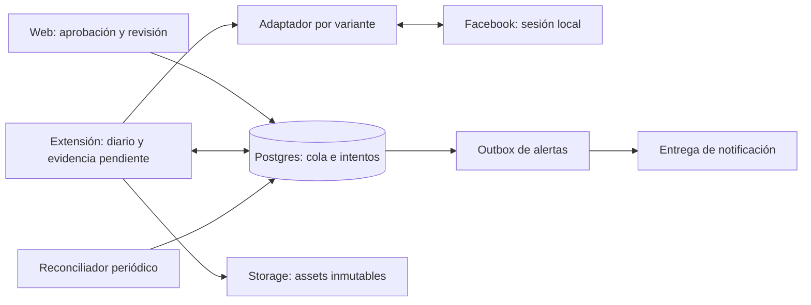

# Auditoría de confiabilidad de RivaStock 2.0

Fecha: 17/10/2026, Argentina. Base: `150a8c1f5e4dfdbb7e694aa3c4955f0595d624e2`. Extensión: **0.5.3**.

## Dictamen

**Recomendación: alternativa B, reestructuración focalizada sobre Postgres y la extensión existentes.** La cola persistente, la identidad de intentos y la autorización única ya están implementadas y tienen pruebas útiles. Reescribirlas no elimina la dependencia del DOM de Facebook. Sin embargo, corregir únicamente selectores tampoco alcanza: hay un contrato de resultados incompatible, recuperación dependiente de la interfaz y ausencia de supervisión autónoma.

**La versión auditada no está lista para declararse autónoma y confiable en operación diaria.** Se reprodujeron dos defectos: un recibo de grupo sin URL bloquea el procesamiento de la PC, y el detector de Marketplace acepta una URL anterior sin acreditar que provenga del intento. Ninguno demuestra por sí solo que haya ocurrido un incidente productivo; sí demuestra comportamiento incorrecto del código distribuido.

Prioridad: corregir el contrato y la atribución de resultados; después cerrar recuperación, reintentos y alertas; finalmente certificar el recorrido real por variante. No introducir Redis, Kafka, un segundo motor de colas ni automatización de navegador en la nube para este alcance.

Este informe entrega investigación, alternativas, diseño y plan. **No se modificó código de aplicación, extensión, pruebas ni migraciones; no se ejecutaron mutaciones productivas ni publicaciones.** Se preservó el cambio previo de `TASKS.md`. Las pruebas generaron artefactos locales y reconstruyeron el paquete de extensión sin cambios en archivos versionados.

## 1. Alcance y calidad de la evidencia

Las conclusiones distinguen:

- **R — Reproducido:** ejecución local del comportamiento, con resultado concreto.
- **C — Comprobado por código:** la implementación permite o carece de un comportamiento identificable; no implica un incidente observado.
- **P — Riesgo potencial:** depende de condiciones externas todavía no observadas.
- **N — No verificado:** falta información del entorno productivo.

Se inspeccionaron el flujo de aprobación y su historial, conexión y configuración, worker, adaptador, acciones DOM, descubrimiento de grupos, almacenamiento de imágenes, empaquetado, inicio con Windows, migraciones 0049–0064 y sus pruebas. Se revisaron `CLAUDE.md`, el plan/handoff vigente y la guía de extensión, contrastándolos con código y Git. Se ejecutaron pruebas de SQL, worker, navegador, concurrencia y dependencias. No se inspeccionaron cookies, tokens de usuario ni contenido de publicaciones reales.

| Componente | Implementación inspeccionada | Papel real |
|---|---|---|
| Web | React 19.2.4, Vite 6.4.3; `FacebookPublicationModal.tsx`, `Automations.tsx`, `PublicationHistory.tsx` | Aprobación, cola, decisiones y revisión humana |
| Cliente de datos | `@supabase/supabase-js` 2.105.1; `facebookPublications.ts`, `facebookConnection.ts` | RPC, consultas y señal local a la extensión |
| Persistencia | SQL 0049–0064; RLS, RPC `SECURITY DEFINER` | Contenido aprobado, entregas, intentos, revisiones, eventos y dispositivos |
| Ejecutor | Chrome MV3, mínimo Chrome 120, extensión 0.5.3 | Abre pestañas con la sesión local de Facebook y opera formularios |
| Archivos | Supabase Storage público; `ImageUpload.tsx`, `db.ts`, `adapter.js` | Guarda fotos del producto y las descarga antes de preparar |
| Distribución | Vercel, `package-facebook-extension.mjs`, `.gitattributes` | ZIP con allowlist, metadata y SHA-256 |
| Pruebas | Vitest 4.1.11, Playwright 1.61.1, PGlite 0.5.9, PostgreSQL 18.4 embebido | Validación local; no certificación de Facebook real |

Las versiones anteriores son las instaladas, comprobadas con `npm ls`, no solamente los rangos de `package.json`.

### Producción: lo comprobado y lo pendiente

Se descargaron en memoria la [metadata pública](https://rivastock.vercel.app/downloads/rivastock-facebook-version.json) y el ZIP de distribución. Ambos corresponden a 0.5.3. El SHA-256 del ZIP remoto coincide con el generado en memoria desde el árbol local:

```text
2472a80fa13c7bf0b7608fc15428b8500378216bc2673f4555f0b45503f7898b
```

Esto verifica **el paquete distribuido**, no el commit completo de la web, la extensión instalada, la política de la cuenta ni el esquema productivo. El tablero aún marca A10/A11 pendientes, mientras su registro declara 0064 aplicada manualmente y despliegue diferido (`TASKS.md`, líneas 43–45 y 274–275). El ZIP público contradice ese estado de despliegue pendiente. Se necesita inventario actual; no corresponde asumir qué SQL está aplicado por el estado del tablero.

## 2. Funcionamiento actual completo

```mermaid
sequenceDiagram
    participant U as Usuario / web
    participant DB as Postgres RPC
    participant W as Extensión MV3
    participant FB as Facebook DOM
    U->>U: Revisar contenido y destinos; guardar intent_key
    U->>DB: approve_facebook_publication
    DB->>DB: Validar permisos; snapshot + entregas pendientes
    U-->>W: Aviso local opcional
    W->>DB: heartbeat + claim con claimKey persistida
    DB-->>W: Entrega + attemptId + lease
    W->>W: Descargar fotos; persistir diario
    W->>FB: Abrir y preparar formulario; verificar valores
    W->>DB: checkpoint
    DB-->>W: authorized_now, una vez por intento
    W->>W: Persistir fase submitting
    W->>FB: Clic final único
    W->>FB: Buscar confirmación y evidencia
    W->>W: Persistir resultado local
    W->>DB: Guardar resultado de forma idempotente
    U->>DB: Consultar historial / registrar revisión
```

1. **Creación.** `FacebookPublicationModal.confirm` valida la aprobación explícita, contenido y destinos; persiste una clave en `localStorage` antes de la RPC. La base verifica acceso al producto, fotos pertenecientes al producto, grupos de la cuenta y restricciones de repetición. Una transacción crea el snapshot y una entrega por destino. Las confirmaciones repetidas con el mismo intent no crean otra publicación. Las guardas se serializan por producto y cuenta.
2. **Activación.** Un aviso desde la web puede despertar la extensión de la misma PC; desde el celular se depende del sondeo. El aviso no autoriza el envío. La alarma nominal es de 30 segundos; inicio e instalación también disparan comprobaciones. La pausa remota y local se verifican antes del claim y del checkpoint.
3. **Claim.** V2 exige capacidades, usa una clave persistida, serializa el dispositivo y toma una entrega con `FOR UPDATE SKIP LOCKED`. Una respuesta perdida se recupera con el mismo intento. No se toma otro mientras ese dispositivo tenga un intento vivo. Las guardas de producto/destino bloquean pendientes, desconocidos y contradicciones según la operación.
4. **Preparación.** Fotos secuenciales, HTTPS del Storage del proyecto, JPG/PNG/WebP y hasta 10 MB por foto. Marketplace revisa coincidencias previas y prepara categoría, estado, precio, ubicación y fotos. Un grupo utiliza texto/fotos; el formato de venta requiere decisión explícita. Los selectores son de UI española. La extensión comprueba contenido y audiencia antes del clic.
5. **Lease y autorización.** El lease inicial es de dos minutos; progress lo extiende hasta un máximo de diez minutos de preparación. `checkpoint` comprueba intento vigente, permisos, pausa y bloqueos, y marca `authorized_at` y `submitted_at`. Este último significa **autorización**, no prueba de que Facebook recibió el clic. Una repetición del checkpoint no vuelve a autorizar.
6. **Envío y resultado.** Se guarda `submitting` antes de hacer clic. `reconcile` sondea 20 veces con intervalos de 750 ms. Un aviso o evidencia del DOM puede producir `submitted`, `published` o `pending_approval`. La búsqueda posterior en el feed de grupos produce solamente una candidata: ya no se convierte automáticamente en éxito. El resultado se guarda localmente antes de enviarlo a Postgres.
7. **Recuperación.** Un diario con resultado vuelve a guardar esa evidencia; uno autorizado se reconcilia sin repetir clic; una preparación interrumpida se retira. Los resultados tardíos se conservan y pueden abrir una contradicción. Una revisión humana no se borra. Las preparaciones fallidas se reintentan manualmente; los desconocidos requieren revisión.
8. **Seguimiento.** La web consulta cada diez segundos mientras está abierta y llama `refresh_facebook_delivery_states`, que vence intentos. No hay un proceso de servidor equivalente registrado en las migraciones inspeccionadas. Tampoco hay sincronización posterior de la decisión de moderación de Facebook.

### Programación y tiempo

**No existe programación para una fecha/hora futura.** No hay `scheduled_at`, recurrencia ni calendario de publicaciones: aprobar encola inmediatamente. La prioridad es antigüedad de aprobación, con Marketplace primero dentro del orden implementado. No hay un scheduler productivo de publicaciones alojado en Vercel o una Edge Function de publicación en el repositorio.

Postgres usa `timestamptz`; los leases se calculan en servidor. `toLocaleString('es-AR')` localiza la presentación, pero no fija la zona horaria del equipo. `deviceConnected` usa el reloj del navegador y rechaza timestamps futuros; un reloj desajustado puede mostrar la PC desconectada sin cambiar la exclusión de claims. Si se incorpora agenda después, almacenar el instante UTC y la zona IANA elegida, definiendo explícitamente qué hacer con horarios ambiguos, vencidos o durante desconexión.

## 3. Hallazgos priorizados

P1: resolver antes de certificar operación autónoma. P2: incorporar al endurecimiento, priorizando según carga y uso. Las referencias de archivo/línea corresponden al commit auditado.

### F01 · P1 · R — Recibo sin URL bloquea la cola y sobrevive a la revisión humana

`extensions/facebook/form-actions.js:545` devuelve `{status:'submitted',url:null}` ante un aviso nuevo sin enlace. `e2e/facebook-receipt.spec.ts:34` lo considera correcto. Sin embargo, `0062_facebook_attempt_recovery.sql:100` rechaza cualquier resultado sin URL excepto `pending_approval`; 0063/0064 mantienen esa regla.

`worker.js:179` ya persistió `stage:'result'`; `saveResult` falla y no lo retira. En el próximo poll, `worker.js:130` intenta guardarlo antes de hacer recover o claim. La revisión humana no lo resuelve porque el servidor valida la URL antes de revisar el estado retirado.

**Reproducción con migraciones reales en PGlite y worker real:** rechazo `P0001 / RESULT_EVIDENCE_INVALID`; dos polls ejecutaron `heartbeat,result,heartbeat,result`, conservaron el diario y no reclamaron otro trabajo. Después de vencer y revisar manualmente el intento, el diario siguió en `result`.

**Corrección propuesta:** contrato único de evidencia. Un aviso sin URL debe registrarse como recibo verificable de alcance limitado, sin fabricar publicación visible. Inicialmente puede conservarse como evidencia de resultado desconocido. Agregar una operación idempotente que persista el recibo/rechazo de contrato y confirme su archivo antes de liberar el diario. No eliminar evidencia ni ensanchar indiscriminadamente la aceptación de `submitted` sin URL.

### F02 · P1 · R — Marketplace atribuye un anuncio existente al intento actual

`form-actions.js:475` acepta cualquier navegación a `/marketplace/item/<id>` como `submitted`. No exige recibo del clic, no excluye la URL del baseline y no verifica contenido/autor en esa rama.

**Reproducción en Chromium con página interceptada:** al abrir el anuncio 999, con otro título aprobado, sin marca de clic y con esa misma URL ya en el baseline, `action('result')` devolvió `submitted` para 999. La prueba demuestra un defecto del detector, no un envío real. La condición puede aparecer si el usuario cambia la pestaña durante ejecución/recuperación o hay una redirección ajena al intento.

**Corrección propuesta:** asociación verificable entre intento, pestaña/documento, clic y evidencia. Una navegación por sí sola debe ser candidata, no confirmación. Si la navegación destruye la prueba local, conservar desconocido; no sustituir causalidad por coincidencia de título. Agregar casos adversos de navegación, baseline y recuperación.

### F03 · P1 · R/C — Errores permanentes presentados como red; sin recuperación del bloqueo

`worker.js:12–20` reconoce sólo algunos mensajes y usa `NETWORK_TEMPORARY` como valor por defecto. PostgreSQL responde `P0001` para estas excepciones, que no satisface la expresión de códigos alfabéticos. Por eso F01 se muestra como «Sin conexión momentánea». También quedan mal clasificados, entre otros, rechazos de contrato y permiso no contemplados. El bucle no distingue error transitorio de permanente, ni respeta `Retry-After`, ni aplica espera creciente.

**Corrección propuesta:** normalizar SQLSTATE, código de dominio y HTTP; separar red/429/5xx, credenciales, política, contenido y contrato. Reintentar transporte con el mismo identificador y presupuesto; poner errores permanentes en revisión con alerta. El archivo de resultados debe ser durable y no bloquear indefinidamente trabajos independientes.

### F04 · P1 · C — Recuperación autónoma incompleta sin interfaz o sin diario

`0062:170–190` requiere usuario autenticado y se llama desde la web. El heartbeat V2 no ejecuta ese vencimiento. `0062:79–80` rechaza nuevos claims cuando existe un intento no finalizado; el worker necesita el ID guardado para llamar recover. Si se pierde el almacenamiento local conservando la vinculación, no hay consulta de rescate para descubrir ese intento. Con la PC detenida y la web cerrada, un `running` puede quedar así indefinidamente.

**Corrección propuesta:** reconciliador de servidor por lotes, con auditoría y bloqueo de carreras, más recuperación del intento propio por dispositivo. Vencer un lease jamás habilita repetir un envío autorizado. Un intento anterior a autorización puede pasar a reintento seguro; uno autorizado pasa a desconocido. Registrar también trabajos pendientes cuyo aprobador ya no tiene permisos: hoy el claim los omite sin convertirlos en bloqueo explícito (`0062:82`).

### F05 · P1 · C/P — Falta control común ante bloqueos de Facebook

El detector identifica login, CAPTCHA y algunas restricciones (`form-actions.js:76–82`), pero normalmente informa una falla de preparación; `worker.js:183,189` puede continuar con la siguiente entrega. No hay enfriamiento por cuenta, límite de frecuencia configurable ni suspensión compartida ante una restricción. Varias entregas pueden abrir más formularios bajo la misma sesión bloqueada. La restricción efectiva de Facebook y sus límites para esta cuenta son N.

**Corrección propuesta:** estado operativo de cuenta/dispositivo `needs_login`, `restricted`, `cooldown` o `ready`, sin cambiar el contenido aprobado. Detener claims ante bloqueos persistentes; mantener las entregas pendientes. Un único ejecutor autorizado para la cuenta actual y separación de la lectura de grupos. El ritmo debe respetar restricciones observadas, no intentar eludirlas; no se propone una cuota «segura» inventada.

### F06 · P1 · C/P — El snapshot no conserva los bytes de las fotos

La aprobación congela URLs (`0049:111–131`), no objetos inmutables. `ImageUpload.removeImage` elimina inmediatamente del Storage (`ImageUpload.tsx:87`), y `db.ts:741` permite upsert. La descarga ocurre más tarde (`adapter.js:7–25`). Una foto borrada deja inutilizable un trabajo aprobado; un objeto reemplazado puede cambiar lo que se publica. La interfaz habitual genera nombres con timestamp, lo que reduce reemplazos accidentales, pero no protege los objetos referenciados.

**Corrección propuesta:** assets de publicación inmutables con hash, tamaño, MIME y referencias persistentes. Conservarlos mientras existan trabajos/historial sujeto a retención. Verificar integridad antes de enviar. Descarga con límite de bytes durante lectura, no sólo tras `arrayBuffer`; límite total por trabajo. Las previews de Facebook no prueban identidad criptográfica de las fotos finales.

### F07 · P1 · C/P — Vincular RivaStock no fija la identidad de Facebook

Los dispositivos se vinculan a la cuenta de RivaStock, no a una identidad esperada de Facebook (`0049`, `pairing.js`). En grupos se obtiene el autor presente en el compositor (`form-actions.js:342–352`), pero no se compara con una identidad aprobada del negocio. Marketplace tampoco tiene esa comparación. Un cambio de sesión/perfil puede publicar desde otra cuenta con formularios válidos.

**Corrección propuesta:** perfil de navegador dedicado y confirmación inicial de identidad visible, guardada como expectativa de la cuenta. Verificarla antes de autorización y justo antes del clic cuando la UI permita hacerlo inequívocamente. Si no puede comprobarse, detener y solicitar revisión. Esto es una protección operacional, no autenticación criptográfica de Facebook.

### F08 · P1 · C/N — Observabilidad insuficiente para operar sin supervisión permanente

Hay estados y eventos persistentes, pero no un canal de alertas proactivas. Los contadores de `Automations.tsx:57–69` son de la página actual, y no sustituyen métricas globales. Los `catch(()=>{})` de latencia/progress/heartbeat (`worker.js:125,162,165,317`) no conservan todas las fallas. El modelo de eventos enumera muchos tipos, pero los caminos de progress, recover, attention y vencimiento no generan una historia completa. La medición de latencias se envía sólo con protocolo menor que 2 (`worker.js:166,168`).

**Corrección propuesta:** eventos estructurados de transición con IDs y errores estables, métricas globales por cuenta, vigilancia del último progreso real y alertas con deduplicación. Un heartbeat reciente no demuestra que los resultados se estén guardando, como muestra F01. No registrar tokens, cookies, HTML completo ni datos de publicaciones ajenas.

### F09 · P1 · R/C — Las pruebas no integran el contrato completo y una suite está roja

88 pruebas de Vitest pasaron. La suite de navegador terminó con **81 aprobadas y 1 fallida**: `e2e/facebook-extension.spec.ts:142` espera el alias `PicoVendedeTodo` y recibe el ID canónico `710102875717376`. Es una discrepancia de expectativa del fixture; no prueba un destino externo incorrecto. El fallo impide declarar la suite verde y deja sin ejecutar las aserciones posteriores de ese caso.

Ese flujo de extensión simula respuestas legacy y acepta resultados sin validación SQL (`facebook-extension.spec.ts:83–90`). Las pruebas de reinicio también simulan las RPC (`facebook-recovery.spec.ts:17`). El fixture de recibos no llama a la base. Por eso un detector puede pasar su prueba y producir un resultado imposible de guardar.

**Corrección propuesta:** conservar las pruebas unitarias, corregir la expectativa canónica una vez verificada y añadir una capa instalada-ZIP → worker V2 → RPC → Postgres real, con Facebook simulado. Los tipos y ejemplos de respuesta deben compartirse entre detector, worker y SQL.

### F10 · P2 · C/P — Variantes, audiencia y selectores necesitan contratos independientes

`form-actions.js` reúne 567 líneas de preparación, envío, búsqueda y verificación. Los aliases de un grupo concreto aparecen en SQL, TS y JS. Las comprobaciones del paso final de Marketplace toleran ciertos controles ausentes, y el formato de venta de grupo no revalida todos los valores/fotos con el mismo contrato de preparación. La rama de venta no produce confirmación pública verificable (`form-actions.js:507`); puede terminar en aprobación pendiente o desconocido.

**Corrección propuesta:** adaptadores separados por variante y validación final de datos, identidad y audiencia observables; versión de contrato y fixtures por variante. Si el paso final oculta un dato crítico, documentar exactamente qué evidencia lo respalda y fallar de forma conservadora ante una variante desconocida. Mantener deshabilitadas las variantes no certificadas. No atribuir que ya hubo contenido incorrecto: es un riesgo a validar.

### F11 · P2 · C/P — Coste de sondeo, lectura de grupos y crecimiento del historial

Una PC activa sin trabajo hace nominalmente heartbeat, claim y comprobación de grupos cada 30 s: unas **8.640 RPC/día**, más mantenimiento y web, si permanece despierta 24 h. Es una estimación del flujo, no una medición de tráfico productivo. El descubrimiento de miembros recorre todos los grupos por lotes y puede coexistir con publicaciones (`worker.js:201–213`). Algunas fallas por grupo se convierten en conteo nulo (`group-discovery.js:62`).

El historial carga intentos y eventos anidados; la vista por producto no pagina publicaciones (`facebookPublications.ts`, `loadFacebookPublicationData`). Las consultas y locks actuales deben medirse con volúmenes representativos antes de agregar índices o servicios.

**Corrección propuesta:** prioridad a publicaciones, mantenimiento de baja prioridad con presupuesto, polling adaptativo manteniendo el tiempo de detección objetivo y detalle de intentos bajo demanda. Añadir índices sólo con `EXPLAIN (ANALYZE, BUFFERS)` y datos de prueba. Conservar eventos; definir archivo/retención sin borrar evidencia para desbloquear.

### F12 · P1 de liberación · R/N — Deriva entre documentación, paquete y entorno

El ZIP público ya coincide con 0.5.3 local, pero el registro indica despliegue pendiente. No se verificaron extensión instalada, política `required_protocol`, definición de funciones productivas, trabajos huérfanos ni reinicio físico. El protocolo V2 convive con compatibilidad legacy; sin inventario no se sabe qué garantías aplican a cada PC. La declaración histórica de una migración manual no sustituye una consulta de catálogo. Además, `FacebookExtensionSettings.tsx:21` considera compatible cualquier respuesta de protocolo 2, sin comprobar `result-candidates`, mientras 0064 sí exige esa capacidad para claim; la UI puede comunicar compatibilidad insuficiente.

**Corrección propuesta:** inventario reproducible de versión/hash, capacidades, migraciones, política y dispositivos; certificación por variante; actualización coherente del registro. El gate actual de capacidades `result-candidates` es útil, pero no prueba por sí solo que el detector no tenga F01/F02.

### Controles valiosos que deben conservarse

La base limita acceso por dueño/permisos mediante RLS y RPC; los backends privados no se exponen a clientes. Los tokens de dispositivo se almacenan hasheados en servidor, vencen y se renuevan sólo cuando son válidos. La extensión solicita permisos opcionales, restringe el origen del emparejamiento y no usa cookies ni endpoints privados de Facebook. Los fetch de fotos/RPC rechazan redirecciones. El ZIP usa una lista explícita de archivos.

Las pruebas de concurrencia confirmaron exclusión de claims, aprobación idempotente, autorización única, bloqueo de evidencia tardía, rechazo de intentos anteriores, pausa/revocación antes de autorización y aislamiento entre cuentas y colaboradores. No se detectó un bypass en esos escenarios. Una pausa posterior al checkpoint no puede deshacer un clic en curso: ese límite debe mantenerse visible.

`npm audit` informó cero vulnerabilidades conocidas. No certifica ausencia de vulnerabilidades, configuración correcta de Storage o secretos seguros en la PC. Backups, restauración, retención, permisos del bucket y protección del equipo siguen sin verificación productiva.

## 4. Comparación de las tres alternativas

Estimaciones orientativas para un desarrollador familiarizado con el proyecto; incluyen implementación y pruebas locales, excluyen esperas de revisión externa. No son compromisos de plazo ni precios de proveedores.

| Criterio | A · Optimizar implementación actual | B · Reestructurar componentes críticos | C · Rediseñar completamente |
|---|---|---|---|
| Alcance | Corregir contratos/selectores, tests y documentación conservando flujo actual | Preservar cola e intentos; contrato único, recuperación servidor, outbox local de evidencia, errores, assets y alertas | Nuevo ejecutor/backend y migración del historial; reevaluación de canal |
| Robustez | Mejora fallas puntuales; autonomía sigue limitada si no se cambia recuperación | Cubre fallas verificadas y recuperación sin UI; mantiene límite externo del DOM | No supera necesariamente B si sigue operando el mismo DOM |
| Complejidad | Baja al principio; deuda de wrappers y estados continúa | Media; complejidad concentrada en contratos explícitos | Alta; dos sistemas durante migración |
| Coste | 3–6 días orientativos para fallas inmediatas; mínimo operativo | 12–20 días orientativos, más observación/certificación; coste incremental de cron/alertas/Storage según plan | 25–45+ días orientativos; operación adicional si se agrega servidor de navegador |
| Mantenimiento | Continúa mezcla de responsabilidades | Adaptadores versionados y transiciones testeables | Base nueva, pero nuevos incidentes y pérdida de experiencia existente |
| Escala | Adecuada a una PC con límites actuales | Adecuada a una cuenta; permite medir antes de ampliar | Puede mejorar escala propia, no la capacidad admitida por Facebook |
| Migración | Baja, aunque contratos requieren compatibilidad | Media, por cambios aditivos y activación gradual | Alta: migrar intentos y evidencia durante efectos externos no transaccionales |
| Dependencia de Facebook | Permanece | Permanece y se contiene | Permanece salvo acceso comprobado a otro canal compatible |

**B es superior para el requisito pedido:** aprovecha mecanismos que pasaron concurrencia real y resuelve fallas que A dejaría estructuralmente expuestas. A es útil como primer tramo de contención, no como destino final de autonomía. C sólo debe reconsiderarse si cambia el requisito —por ejemplo, disponibilidad sin PC del negocio— o se acredita una integración oficial que soporte exactamente los destinos y permisos necesarios.

No se promete reemplazar Marketplace/grupos por Graph API. El proyecto no implementa ese canal. El plan anterior cita la retirada de Groups API; el intento de consultar el changelog oficial durante esta auditoría respondió HTTP 429. Por lo tanto, la viabilidad actual de una API alternativa se deja como investigación condicionante, no como hecho verificado ni fundamento necesario de la recomendación.

## 5. Diseño recomendado

### Arquitectura mínima



Se conserva `facebook_deliveries` como cola durable. Las tablas de intentos/eventos ya resuelven buena parte del trabajo; no se agrega otra cola de publicaciones. Un job de servidor procesa vencimientos y observabilidad. Supabase documenta Cron sobre `pg_cron`, con ejecución de funciones SQL y registro de runs; su disponibilidad concreta debe verificarse en el proyecto antes de habilitarlo. [Documentación oficial de Supabase Cron](https://supabase.com/docs/guides/cron).

La extensión continúa siendo un ejecutor interrumpible. Chrome puede terminar service workers; los datos relevantes deben persistirse y las alarmas no constituyen una garantía de ejecución exacta. Eso justifica diario, recuperación y servidor supervisor; no mantener artificialmente vivo al worker como solución de confiabilidad. [Ciclo de vida oficial de Chrome](https://developer.chrome.com/docs/extensions/develop/concepts/service-workers/lifecycle).

### Estado persistente y evidencia

Mantener IDs existentes y compatibilidad de lectura. Separar conceptualmente estado de ejecución de fuerza de evidencia; no exigir una migración destructiva de todos los estados de una sola vez.

| Situación | Estado/acción recomendada | Nuevo envío automático |
|---|---|---|
| Aprobada, todavía no tomada | Pendiente; aplicar disponibilidad/ritmo | Sí, primera ejecución |
| Preparación activa | Lease vigente, attemptId, progreso | No, ya está asignada |
| Fallo transitorio antes de autorización | Reintento programado del mismo delivery con nuevo intento auditado | Sí, con guardas y presupuesto |
| Login, restricción, contenido o contrato incompatible | Bloqueo explícito con causa | No hasta resolver la causa |
| Checkpoint concedido | Posible efecto externo; preservar incertidumbre | Nunca repetir ese intento |
| Aviso causal sin permalink | Guardar recibo; visibilidad no verificada; inicialmente revisión conservadora | No |
| Resultado con evidencia suficiente | `submitted`, `pending_approval` o `published` según contrato | No |
| Timeout/cierre después de autorización | Desconocido, con evidencia/candidatas | No |
| Evidencia tardía contradictoria | Bloqueo por producto/destino y revisión auditada | No |
| Rechazo permanente al guardar evidencia | Cuarentena durable y alerta de contrato | No para ese delivery; otros sólo tras conservar evidencia |

Contrato propuesto: `attemptId`, `deliveryId`, `evidenceKind`, versión de adaptador, `observedAt`, URL opcional según tipo y datos mínimos permitidos de correlación. Tipos posibles: `causal_receipt`, `verified_post`, `candidate`, `manual_review`, `contract_rejection`. La API valida estructura y destino; **no puede probar por sí sola que un cliente de navegador no miente**. La garantía supone un ejecutor confiable y las comprobaciones DOM especificadas.

Mantener resultados pendientes de persistir en un outbox local por attemptId, con identificador estable. Un corte entre confirmación de la base y retiro local se resuelve repitiendo la misma operación idempotente. Liberar el trabajo solamente al confirmar persistencia o cuarentena durable; una caída total del servidor conserva el diario y detiene el flujo. No copiar una candidata al campo de evidencia confirmada.

### Reintentos y reconciliación

Tres políticas distintas:

1. **Transporte hacia Postgres:** misma clave/attempt/event ID; espera exponencial con jitter y tope, respetando `Retry-After`. Presupuesto de tiempo antes de alertar. Respuesta JSON inválida no equivale a que la transacción no ocurrió.
2. **Preparación anterior a autorización:** hasta tres intentos automáticos como política inicial a validar, por ejemplo demoras de 30 s, 2 min y 10 min; sólo para red/descarga transitoria. Un nuevo intento se habilita transaccionalmente comprobando que ninguno fue autorizado. No reintentar automáticamente sesión, CAPTCHA, permisos, contenido cambiado o contrato DOM desconocido.
3. **Después de autorización:** sólo reconciliar y guardar evidencia; ningún clic automático adicional. Una revisión `not_found` no prueba ausencia absoluta del post. Un nuevo envío exige aprobación informada y deja relación con el anterior.

El reconciliador corre inicialmente cada minuto, procesa lotes acotados y usa el mismo orden de locks que las operaciones interactivas. Expira leases, registra transiciones, marca permisos revocados y genera alertas. Su función privilegiada no se concede a `anon`/`authenticated`; no reutilizar sin cambios la RPC que depende de `auth.uid()`. Debe ser idempotente y seguro frente a un resultado que llega simultáneamente.

### Monitoreo e intervención

Medir por cuenta: profundidad/edad de pendientes, último claim/checkpoint/resultado persistido, edad de heartbeat, intentos vencidos, desconocidos, errores permanentes, latencia de resultado y versión de cada dispositivo. Separar «PC conectada» de «Facebook listo» y «cola progresando».

Alertar cuando haya backlog y PC ausente más de cinco minutos, resultado desconocido, rechazo de contrato, credencial inválida, restricción o reconciliador sin ejecutar. Persistir una alerta por incidente con recuperación/cierre, no una por cada poll. El canal y destinatario se configuran explícitamente al implementar; este informe no envía mensajes ni crea automatizaciones.

Intervención humana necesaria: login/CAPTCHA, restricción de Facebook, cambio de identidad, evidencia ambigua/contradictoria, datos faltantes y actualización de variante no soportada. El resto debe recuperarse automáticamente si las dependencias vuelven antes del presupuesto acordado. No afirmar «autonomía total» frente a decisiones de Facebook.

### Seguridad, rendimiento y recuperación de desastres

Conservar RLS, hash de tokens, scopes y allowlists; no usar service-role en extensión. Registrar identidad aprobadora, revisor y versión de ejecutor sin exponer secretos. En una nueva vinculación, preferir cola inicialmente pausada y activación separada; hoy `connect.js:109` la activa al guardar la conexión. La UI sí anuncia «Conectar y activar esta PC»: se propone separar ambas acciones para facilitar una instalación controlada, no se afirma que la activación actual sea oculta.

Usar assets por hash o versión sin overwrite y bloquear eliminación mientras estén referenciados. Reducir sondeo o agrupar lectura sólo después de medir, preservando latencia de inicio. Serializar la ejecución de la cuenta actual sin construir multicuenta. No paralelizar publicaciones para resolver un backlog causado por Facebook.

Definir backup/restore de Postgres y Storage conjuntamente. Restaurar una base anterior a un clic puede borrar su autorización histórica mientras el post externo continúa existiendo: tras una restauración, pausar la cola y reconciliar el intervalo perdido antes de habilitar claims. No hay RPO/RTO productivos comprobados en esta auditoría.

## 6. Plan de implementación y migración

Los números de migración se asignarán al ejecutar el plan según los disponibles; no modificar retroactivamente 0049–0064.

| Paso | Trabajo concreto | Dependencia / aceptación |
|---|---|---|
| 0 · Inventario y baseline | Consultar catálogo/funciones, políticas, versión/hash instalado, dispositivos, cola e intentos; guardar snapshot de configuración sin secretos | Antes de mutar producción; conciliar `TASKS.md` y paquete público |
| 1 · Contención del contrato | Reproducciones F01/F02 como regresiones; clasificador de errores; conservar recibos sin URL; retirar diario sólo con ACK durable | Sin falsos éxitos, sin pérdida de evidencia ni bucles permanentes silenciosos |
| 2 · Contrato y transiciones | Esquema aditivo de evidencia, RPC idempotente, migración de lectura compatible, pruebas con Postgres real | Cliente viejo compatible para rescate; gate para nuevos claims de clientes insuficientes |
| 3 · Recuperación del servidor | Recuperar intento por dispositivo, sweeper por lotes, permisos revocados, eventos y métricas globales | Recuperación probada con web cerrada y diario ausente; jamás reenvío autorizado |
| 4 · Política operativa | Esperas persistidas, presupuesto de reintentos, enfriamiento y exclusión por cuenta; prioridad sobre mantenimiento de grupos | Fallas transitorias recuperan; login/restricción detienen nuevos envíos |
| 5 · Assets e identidad | Fotos inmutables/hash/retención; expectativa de perfil; validación final por variante | Borrado/alteración de fotos o cambio de cuenta impiden envío incorrecto |
| 6 · Alertas y mantenimiento | Outbox de incidentes, canal configurado, estados de recuperación y rollback; modularizar DOM y simplificar dispatcher manteniendo permisos | Alerta sin UI, deduplicada, con IDs y causa; pruebas de contrato intactas |
| 7 · Liberación gradual | Base compatible primero, paquete/web después, actualización del perfil, gate requerido y canario por variante | Hashes verificados; cero regresiones locales; autorización productiva específica |
| 8 · Certificación y observación | Casos reales nuevos aprobados, varios destinos desde celular, reinicio, suspensión/red y seguimiento durante 7–14 días | Evidencia por entrega; registrar límites y tasas observadas |

Para la migración, inventariar `active_attempt_id`, `authorized_at`, diarios y resultados pendientes. No convertir desconocidos en pendientes ni limpiar `submitted_at`. Los recibos antiguos se incorporan con origen/versionado; las fotos antiguas que ya faltan se marcan como bloqueo, no se sustituyen silenciosamente. Desplegar validación de servidor antes que el cliente que la requiere y activar el gate sólo después de comprobar recuperación de clientes anteriores.

Rollback operativo: pausar nuevos claims y conservar procesamiento de evidencia/revisiones. Corregir hacia adelante con migraciones y versiones compatibles; no bajar protocolo ni restaurar snapshots antiguos como forma de «destrabar». Documentar quién puede habilitar nuevamente cada variante. Las acciones productivas de este plan quedan pendientes de ejecución, no autorizadas por haber auditado.

## 7. Validación y criterios de aceptación

### Evidencia ejecutada en esta auditoría

| Comprobación | Resultado | Alcance |
|---|---|---|
| TypeScript, `npm run lint` | Aprobado | Tipos del proyecto |
| Vitest focalizado, 11 archivos | **88/88**, 5,12 s | SQL PGlite, worker, conexión, paquete, helpers |
| Playwright, 8 archivos, dos workers | **81/82**, 106,33 s; un fallo de URL esperada | UI/DOM controlados y extensión instalada; RPC simuladas |
| Concurrencia | **20/20 rondas**, PostgreSQL 18.4 real | Exclusión, idempotencia, late evidence, pausa/revocación, aislamiento |
| Auditoría npm | **0 vulnerabilidades conocidas** | Base de advisories consultada en esta fecha |
| Paquete local/remoto/metadata | SHA-256 idéntico, 0.5.3 | Distribución, no instalación |
| Sonda F01 con worker + migraciones | Defecto reproducido, incluso tras revisión | Datos sintéticos, sin Facebook ni Supabase productivo |
| Sonda F02 en Chromium | Acepta anuncio anterior sin prueba de clic | Detector real con DOM interceptado |

El build de modo e2e se ejecutó como requisito de Playwright. No se ejecutó `npm run verify` completo ni un benchmark de capacidad productiva; no se presenta como aprobado. El resumen durable de evidencia está en [AUDIT-2026-10-17-EVIDENCE.md](./AUDIT-2026-10-17-EVIDENCE.md). Los artefactos transitorios de navegador están bajo `test-results/audit-2026-10-17-playwright/`; la concurrencia generó `test-results/facebook-concurrency.json`.

### Matriz de pruebas que falta incorporar

| Capa | Casos obligatorios | Aserción principal |
|---|---|---|
| Contrato | Cada salida real del detector contra RPC real: recibo sin URL, URL, pendiente, candidata, desconocido, rechazo | Se persiste o se pone en cuarentena; nunca atasca silenciosamente el worker |
| Integración instalada | ZIP real + worker V2 + Postgres + DOM simulado, aprobación hasta UI final | Mismos IDs, evidencia y estado en todos los componentes |
| Corte de proceso | Antes/después de guardar claim; después del commit antes de ACK; preparación; checkpoint antes/después de ACK; clic; captura; persistencia | Una autorización por intento, ningún segundo clic tras autorización, ninguna evidencia descartada |
| Red | Timeout, DNS, 429 con `Retry-After`, 500/503, JSON roto, cuerpo incompleto, commit exitoso con respuesta perdida | Reintento idempotente; espera persistida; error permanente distinto de red |
| Concurrencia | Mismo/diferente intent, varias PCs, claim/cancel, pausa/checkpoint, reintento/sweeper, revisión/resultado tardío | Sin doble claim/clic; locks sin deadlock; contradicción bloquea destino |
| Facebook | Navegación a post viejo, feed tardío, alias, autor/texto/fotos incorrectos, toast efímero, cambios DOM | No atribuir éxito por una coincidencia no causal |
| Identidad y seguridad | Cambio de sesión, permisos revocados, token vencido, otro tenant, payload excesivo, origen de pairing ajeno | Detener operación y conservar trazabilidad, sin exposición de secretos |
| Archivos | 404, MIME falso, bytes truncados, objeto reemplazado/borrado, descarga lenta, falta de `Content-Length` | Nunca publicar fotos distintas o incompletas; memoria y tiempo acotados |
| Operación | Web cerrada, PC apagada/suspendida, worker detenido, pérdida de diario, actualización, reinicio físico | Servidor detecta bloqueo; recuperación comprobada sin reenvío incierto |
| Tiempo | Reloj cliente adelantado/atrasado, timestamps fuera de orden; agenda sólo si se agrega | Servidor decide vencimientos; UI explica zona y no corrompe orden |
| Capacidad y restore | Backlog/historial representativo, límites del plan, restauración del intervalo con clics | Mantener SLO y no ejecutar automáticamente entregas resucitadas |

### Umbrales propuestos, todavía no logrados

- **Integridad:** 0 aprobaciones reconocidas perdidas en 10.000 operaciones sintéticas; todas trazables por intent/delivery/attempt. No equivale a garantía contra pérdida de la base fuera de su política de backup.
- **Duplicados:** 0 clics repetidos del mismo intento en toda la matriz de fallas; 0 entregas concurrentes no permitidas por producto/destino. Aumentar las carreras a al menos 1.000 rondas aleatorizadas antes de certificar los nuevos mecanismos.
- **Resultados:** 100% de respuestas del detector tienen tratamiento contractual y persistencia o cuarentena verificable. Cero candidatos o navegaciones ajenas promovidos automáticamente.
- **Recuperación:** todo lease vencido se clasifica en ≤2 minutos adicionales al vencimiento, con servidor sano y sin abrir la web. Un resultado pendiente de ACK se guarda en ≤5 minutos tras recuperar conectividad y compatibilidad, sin nuevo clic.
- **Trazabilidad:** cada transición relevante incluye IDs, fecha de servidor, versión y causa; cada revisión conserva actor y evidencia. Ningún resultado desconocido se oculta bajo un mensaje de red.
- **Detección:** alerta de PC ausente con backlog en ≤5 minutos; alerta de contrato/desconocido en ≤2 minutos desde su persistencia; un incidente no produce notificaciones repetidas por poll. Verificar el canal de alertas y la salud del propio monitor.
- **Latencia:** proponer p95 de claim ≤60 s con PC despierta, sesión lista, cola activa y sin limitación ni backlog previo. Medir antes de comprometer un objetivo de publicación final; DOM y moderación no tienen plazo controlable.
- **Operación real:** 7–14 días observados, todas las entregas contabilizadas, cero duplicados atribuibles a reejecución automática y cero fallas sin diagnóstico. Informar muestra, variantes, porcentaje de desconocidos y minutos de intervención; no convertir una muestra pequeña en promesa de 100%.

### Garantías alcanzables y límites

Puede garantizarse, dentro del sistema y sus supuestos, aprobación transaccional, consumo exclusivo, una autorización por intento, reintento idempotente de persistencia, conservación de incertidumbre y detección acotada de bloqueos. **No hay transacción atómica entre Postgres y Facebook.** Un corte tras el clic deja un intervalo en el que impedir duplicados requiere aceptar un resultado desconocido y posible intervención.

No se garantiza aprobación de moderación, visibilidad permanente, estabilidad de selectores, ausencia de bloqueos externos, disponibilidad con la PC apagada ni ausencia de duplicados creados manualmente o mediante una nueva aprobación. La estrategia prioriza seguridad del envío sobre completar siempre automáticamente.

## 8. Información faltante para ejecutar y certificar

Esta información no impide el dictamen local, pero es imprescindible para afirmar garantías productivas:

| Dato faltante | Motivo concreto |
|---|---|
| Catálogo SQL efectivo 0049–0064, política V2, grants/RLS y cron activo | Determinar qué garantías y contratos están realmente desplegados; no deducirlo del ZIP |
| Dispositivos activos, versión/hash instalado y perfil de Chrome | Evitar clientes antiguos o ejecución bajo otra sesión |
| Conteos y antigüedad de entregas, intentos abiertos, desconocidos y contradicciones | Dimensionar saneamiento sin reenviar ni borrar historial |
| Variantes/destinos realmente utilizados y volumen diario | Priorizar certificación, ritmo y capacidad; no construir multicuenta innecesaria |
| Perfil/identidad de negocio esperado y productos nuevos aprobados para canarios | Verificar envío real al destino correcto sin reutilizar anuncios existentes |
| Configuración de energía/inicio, permisos Storage, plan/backup y restauración | Evaluar disponibilidad, conservación de assets y RPO/RTO |
| Canal y responsable de intervención | Cerrar incidentes que Facebook impide resolver automáticamente |

El siguiente paso técnico recomendado es implementar las regresiones y la contención F01–F03 antes de certificar o ampliar uso, en paralelo conceptual con el inventario productivo de sólo lectura. Este informe no marca completadas las tareas antiguas ni reemplaza silenciosamente su plan.

---

# Anexo B0 — Verdad de producción verificada (17/10/2026, 14:00 ART)

Este anexo lo agrega una auditoría paralela. **No modifica ni contradice el cuerpo del informe anterior**; aporta la evidencia productiva que la §8 declaraba faltante, y corrige dos puntos del estado local con medición propia.

## B0.1 Criterio 1 de `PLAN.md` §1: **CUMPLIDO en su totalidad**

| Punto | Estado | Evidencia |
|---|---|---|
| Migraciones 0049–0064 aplicadas | ✅ | Q5: las 15 funciones de control existen en `pg_proc`, incluidas `facebook_worker_base`, `_legacy_dispatch`, `_before_timing`, `_before_decisions`, `_before_final_gate`, `facebook_worker_v2_validated_state`, `facebook_destination_key`, `facebook_validate_issue`, `review_facebook_attempt` |
| Web desplegada desde un commit identificado | ✅ | `version.json` → `0.5.3`, sha256 `2472a80f…`; recalculado con `extensionArchive` sobre `git archive 150a8c1` (LF) → **hash idéntico** |
| Extensión de esa misma versión instalada en el perfil | ✅ | `chrome://extensions`: «RivaStock · Facebook» **0.5.3**, activada, ID `iplfoimfiigmoaihampblmibohekbbkj` |
| `required_protocol=2` activa | ✅ | Q1: `required_protocol = 2`, `updated_at = 2026-10-15 18:46:40+00` |

Además, Q2 confirma el supuesto **S1** (una sola PC) y que la compuerta de capacidad de 0064 **pasa**:

```
name: Chrome de RivaStock · last_seen_at: 2026-10-17 16:58:45+00 (17 s) · queue_enabled: true
execution_state: active · worker_protocol: 2 · extension_version: 0.5.3
capabilities: ["attempts","causal-results","recovery","result-candidates"]
last_error_code: PREPARATION_INTERRUPTED
```

**Consecuencia para la planificación: A01, A10, A11, A12 y A13 están hechas.** Las fases 0, 1 y 2 del plan están cerradas. El registro de `TASKS.md` que dice «Sin push» y «A11/A12 diferidos» es falso. Es la tercera vez que ese registro declara un estado productivo que ya no era cierto (H1 de `PLAN.md` fue la primera). **El registro de ejecución no es fuente de verdad; solo lo son los hashes y las consultas.**

## B0.2 Criterio 4: **INCUMPLIDO — 41 trabajos huérfanos**

Q3 devuelve **41 filas** en `pending`/`running`/`attention`/`recovery_required`. Las inspeccionadas comparten el mismo perfil, y es el perfil seguro:

```
status = attention · recovery_required = false · submitted_at = NULL
active_attempt_id = NULL · tiene_evidencia = false
```

`submitted_at = NULL` en todas significa que **ninguna llegó a autorizar un envío: cero clics, cero publicaciones, cero riesgo de duplicado**. Son «Preparación fallida», recuperables con «Reintentar preparación».

Causas, por mensaje:

| Mensaje | Destino | Lectura |
|---|---|---|
| «El texto del editor no coincide con el aprobado» (×~8) | grupos, 15/10 01:40–01:42 | `matchesEditor` fallando. Es **exactamente** lo que corrigieron `10bd4c3` (salto final de Lexical) y `150a8c1` (codificación de espacios). Estas fallas son **anteriores** a esos commits → probablemente ya corregidas, **sin verificar** |
| «Facebook no respondió a tiempo durante: grupo sin ed…» (×~5) | grupos, 15/10 01:27–01:38 | Timeout de `wait()` (60×250 ms) en `group_prepare` |
| «Ya existe un anuncio con este título. Verificá…» | Marketplace, 14/10 21:04 | `issue` de tipo `marketplace_conflict`: espera una **decisión humana** (`resolve_facebook_delivery`) desde el 14/10 |
| «No se pudo verificar el formulario de Facebook» | Marketplace, 14/10 22:23 | Fallo de `check_existing` |

Dato de proceso: una sola aprobación del 15/10 01:26:05 generó **más de una docena** de destinos de grupo. D-A6 fija un máximo de 3 grupos por aprobación para la certificación; conviene respetarlo también en operación hasta medir el riesgo de restricción por volumen.

Estado actual de la cola: **activa, conectada, inactiva por falta de trabajo**. Las 41 están en `attention`, que no es reclamable. La cola **no está bloqueada**; el diario local tampoco (`last_error_code = PREPARATION_INTERRUPTED`, no `RESULT_UNKNOWN`).

## B0.3 El defecto de canonicalización de grupos **ya está activo**, no es latente

La identidad canónica de un grupo se resuelve con un `replace` literal de **un** slug concreto, repetido en siete lugares de producción: `0053:80-82` (`facebook_group_key`), `0053:59`, `0049` y `0052` (validadores de evidencia), `form-actions.js:330,492`, `group-discovery.js:18,35`, `facebookPublications.ts:22`.

Q4 muestra **69 grupos**, de los cuales **tres tienen URL con nombre y ninguna entrada de alias**:

```
https://www.facebook.com/groups/empleosengeneralpico.lp
https://www.facebook.com/groups/mayoristasyrevendedoresdetecnologiaelectronicaargentina…
https://www.facebook.com/groups/reddeexportadoreseimportadoresargentina
```

Su `clave_canonica` es igual a su `url`. Si Facebook resuelve el permalink de un post de cualquiera de esos tres a la forma numérica —que es justamente lo que obligó a hardcodear el grupo actual—, entonces `facebook_valid_evidence_url` rechaza la evidencia con `RESULT_EVIDENCE_INVALID`, **que es el disparador de F01**. Y la revisión humana tampoco cierra el caso: `review_facebook_attempt('found', url)` usa el mismo validador, así que la única acción que el servidor acepta es «No la encontré», factualmente falsa.

**Evidencia reproducible dentro del propio repositorio:** `e2e/facebook-extension.spec.ts:142` **está en rojo** por este motivo exacto [P]:

```
Expected: p_url: "https://www.facebook.com/groups/PicoVendedeTodo/posts/123456789"
Received: p_url: "https://www.facebook.com/groups/710102875717376/posts/123456789"
```

El worker emite la forma numérica mientras el destino aprobado está en forma de nombre. Hoy eso no rompe producción **solo porque el hardcode mapea ese par**. Para los otros tres grupos no hay mapeo.

Corrección: sustituir el `replace` por una tabla de alias (`facebook_group_aliases(user_id, slug, group_ref)`) aprendida en el descubrimiento, con el par actual cargado como una fila de datos y no como código. `facebook_group_key` pasa de `IMMUTABLE` a `STABLE` y gana `SET search_path=public,pg_temp` (hoy es la única función del módulo sin él). Verificado [I]: no se usa en ningún índice ni `CHECK`, así que el cambio de volatilidad es seguro.

## B0.4 Correcciones de medición

**Las pruebas locales NO están todas verdes.** Medición propia [P] del 17/10:

| Suite | Resultado |
|---|---|
| `tsc --noEmit` | ✅ sin errores |
| `vitest run src` | ✅ 71 archivos, **412 pruebas**, 6,9 s |
| `test:facebook:concurrency` | ✅ PASS, 20 iteraciones sobre PostgreSQL real |
| Playwright, 7 suites de Facebook | ❌ **59 pasaron, 1 falló** (`facebook-extension.spec.ts:142`) |

Esto confirma F09 del informe anterior y corrige cualquier lectura de «local verde». El único fallo es el descrito en B0.3: no es un problema de la prueba, es el defecto de alias manifestándose.

**El vigilante por cron necesita habilitar la extensión.** Q6: `pg_extension` no tiene `pg_cron` (0 filas). Supabase permite habilitarlo desde Database → Extensions en todos los planes; si se prefiere no tocar extensiones, la alternativa es una Edge Function programada que invoque el RPC con `service_role`. La decisión es del titular.

## B0.5 Hallazgo nuevo: error interno de Chrome expuesto como estado al usuario

El panel de la extensión muestra, textualmente:

> Cola activa. Último envío requiere revisión: **Frame with ID 0 was removed.**

Es el error crudo de `chrome.scripting.executeScript` cuando la pestaña o el marco se destruyen durante la ejecución (navegación o cierre). Dos problemas:

1. No se traduce ni se clasifica: llega al usuario un mensaje interno de Chrome, sin acción posible asociada.
2. `errorCode()` (`worker.js:12-20`) no lo reconoce y cae en `NETWORK_TEMPORARY`, el mismo defecto que el informe anterior describe en F03.

Refuerza F03 y conviene incluirlo en la normalización de errores: el origen del fallo no es solo PostgreSQL (`P0001`), también son las APIs de Chrome.

## B0.6 Conciliación con el dictamen anterior

Coincido con **alternativa B focalizada**. Mi análisis paralelo había etiquetado esto como «optimizar lo actual», pero la evidencia de F01 lo decide: el contrato de evidencia entre la extensión y el SQL está **roto**, no degradado —la extensión emite un resultado que el servidor rechaza por diseño en el camino más común—, y eso se arregla rediseñando el contrato, no parcheando un selector. La diferencia entre ambas etiquetas era nominal: las dos conservan Postgres y la extensión, y las dos rechazan Redis, Kafka y navegador headless en la nube.

Puntos donde este anexo aporta algo distinto:

- El defecto de alias de grupos (B0.3) como **causa raíz de un disparador de F01**, con tres grupos productivos ya expuestos y una prueba del repositorio en rojo que lo demuestra.
- La verdad productiva completa (B0.1): el plan está más avanzado de lo que su propio registro dice.
- El inventario real de huérfanos (B0.2) y su clasificación por causa.
- La no disponibilidad de `pg_cron` (B0.4), que condiciona el diseño del vigilante.

## B0.7 Orden recomendado con esta evidencia

1. **Contrato de evidencia** (F01 + F03 + B0.5): recibo sin URL, normalización de errores SQLSTATE/HTTP/Chrome, y estado terminal del diario con techo de reintentos. Es lo único que hoy puede matar la cola.
2. **Alias de grupos** (B0.3): desbloquea los tres grupos expuestos y pone la prueba en verde.
3. **Atribución de Marketplace** (F02): navegación = candidata, nunca confirmación.
4. **Vigilante y alertas** (F04 + F08): Edge Function programada o `pg_cron` habilitado.
5. **Saneamiento de los 41 huérfanos** (criterio 4): uno por uno, decidiendo reintentar o cancelar. Ninguno publicó nada, así que no hay riesgo de duplicado en esta tarea.
6. **Certificación real** (A14–A18), recién después.
