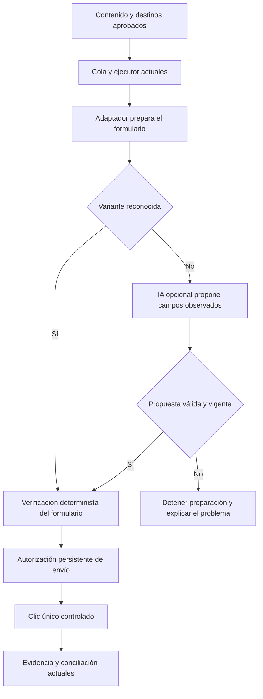

# IA local para RivaStock: asistencia opcional antes de publicar

Fecha: 17 de octubre de 2026. Estado: investigación y propuesta; integración y rendimiento todavía no probados.

**Recomendación: terminar los controles de confiabilidad actuales y evaluar una IA local como ayuda acotada para interpretar formularios.** Puede reducir fallos de preparación y mantenimiento ante cambios de Facebook. No hay evidencia todavía de que reemplazar la automatización por un agente autónomo permita terminar antes. Para ofrecer RivaStock a otros negocios, la IA local debe ser una capacidad opcional, con el mismo contrato de ejecución que el sistema sin IA.

La investigación incluye lectura del código, revisión del plan y la auditoría, inventario local de LM Studio y documentación primaria de modelos, motores y navegador. No incluye inferencia, mediciones de velocidad, instalaciones de modelos ni publicaciones reales.

## 1. Qué significa «acelerar»

Hay tres objetivos diferentes, y conviene medirlos por separado:

| Objetivo | Aporte posible de IA local | Evaluación para RivaStock |
|---|---|---|
| Terminar el desarrollo | Proponer adaptadores, analizar fallos y ayudar a preparar casos de prueba | Útil como herramienta del desarrollador. No requiere incorporarla al producto. Sus propuestas necesitan revisión y pruebas independientes. |
| Publicar más rápido | Interpretar pantallas en cada paso | Agrega inferencia donde hoy hay operaciones directas. No asumir mejora de velocidad; podría reducir el tiempo total solo si evita intervenciones o fallos frecuentes. |
| Mantener la automatización funcionando | Identificar campos o variantes cuando cambian las etiquetas y estructuras | Es la hipótesis con mayor valor para un piloto. Debe demostrar recuperación correcta con límites de tiempo y acciones. |

Un modelo puede elegir un campo de descripción a partir de sus etiquetas y contexto. No puede decidir con certeza que Facebook recibió un envío cuando se cortó la conexión después del clic. Esa incertidumbre exige evidencia y recuperación, aunque el modelo sea muy capaz.

## 2. Relación con los problemas reales del proyecto

La [auditoría](AUDIT-2026-10-17.md) y el [plan vigente](PLAN.md) describen trabajo de confiabilidad que sigue siendo necesario con cualquier motor de IA.

| Problema | ¿La IA lo resuelve? | Responsable propuesto |
|---|---|---|
| Resultado sin URL que no encaja en el contrato del servidor | No | Contrato de evidencia, almacenamiento de recibos y estados revisables |
| Reintentos permanentes que bloquean el procesamiento | No | Clasificación de errores, límite de intentos y salida persistente |
| Atribuir un anuncio anterior al envío actual | No con una opinión del modelo | Evidencia causal y conciliación; revisión ante ambigüedad |
| Identidad de cuenta o negocio incorrecta | No como única verificación | Vinculación de cuenta, perfil y dispositivo; controles del ejecutor |
| Editor o campo cambiado | Potencialmente | IA propone una correspondencia; el adaptador verifica antes de actuar |
| Explicar una pantalla inesperada | Potencialmente | Diagnóstico orientativo, acompañado de evidencia observable |
| PC apagada, sesión vencida, cola abandonada | No | Recuperación, estado operativo y alertas |

**Estado del árbol de trabajo:** durante esta investigación se observaron cambios ajenos en `worker.js`, pruebas, interfaz y la nueva migración `0065_facebook_evidence_receipts.sql`, además del manifest 0.5.4. Incluyen tratamiento de recibos y errores permanentes. Se preservaron. No se certificó aquí su funcionamiento ni su despliegue. Los hallazgos de la auditoría describen su base histórica; no deben confundirse con una afirmación de que todos siguen pendientes en la versión en desarrollo.

El registro actual de `TASKS.md` también contiene verificaciones productivas incorporadas después de la auditoría inicial. Este informe no las repite como comprobaciones propias ni sustituye el registro de certificación.

## 3. Viabilidad en la PC disponible

La captura aportada muestra Ryzen 7 5700G, 16 GB de RAM y Radeon RX 6700 XT con 12 GB de VRAM. La consulta local confirmó Windows 11 Pro y la RX 6700 XT, con controlador `32.0.21045.5002`. Al consultar había aproximadamente 4 GiB de RAM libre; es una fotografía del uso en ese momento, no una limitación permanente.

| Consulta local | Resultado |
|---|---|
| Localización de herramientas | `lms.exe` disponible en `C:\Users\USER\.lmstudio\bin`; no se localizaron `ollama` ni `llama-server` en PATH |
| `lms ls --json` | Solo `nomic-embed-text-v1.5.Q4_K_M.gguf`, 84.106.624 bytes, tipo embedding |
| `lms ps --json` | Lista vacía: ningún modelo cargado |
| `lms runtime ls` | `No runtimes found.` |

El modelo de embeddings encontrado no es un asistente generativo para interpretar formularios o elegir acciones. Las consultas de inventario activaron el servicio de LM Studio automáticamente; no se descargaron modelos ni motores.

**Conclusión de hardware:** la PC justifica probar un modelo pequeño cuantizado, empezando por 4B. La compatibilidad efectiva, el consumo y la latencia requieren una carga real. Los 12 GB de VRAM y los 16 GB de RAM son recursos distintos; no deben sumarse como una única reserva de memoria.

Para AMD en Windows, probaría primero el runtime Vulkan de LM Studio. AMD documenta tanto Vulkan como ROCm en LM Studio. La lista de GPU AMD para Windows de Ollama no incluye la RX 6700 XT en su ruta ROCm; Ollama también documenta una ruta Vulkan adicional. Esto hace razonable evaluar Vulkan, pero no certifica esta combinación de placa, controlador, modelo y runtime. [Guía de AMD](https://developer.amd.com/playbooks/lmstudio-rocm-llms/), [compatibilidad de Ollama](https://docs.ollama.com/gpu).

La prueba debe verificar que se usa la RX 6700 XT y no la gráfica integrada del 5700G. No se recomienda comprar hardware antes de medir. Ampliar RAM podría dar margen para trabajar con navegador y herramientas abiertas, pero no corrige errores de decisiones del modelo.

## 4. Modelo y motor para una primera evaluación

**Primer candidato: Qwen3.5-4B cuantizado, en LM Studio con Vulkan.** Es un candidato por tamaño y capacidades, no un ganador demostrado ni una afirmación de que sea el modelo más reciente. Su ficha oficial describe entrada de texto e imagen y licencia Apache 2.0. [Ficha de Qwen3.5-4B](https://huggingface.co/Qwen/Qwen3.5-4B).

El catálogo de LM Studio ofrece Qwen3.5-4B con una descarga indicada de 3,75 GB y Qwen3.5-9B de 7 GB. Esas cifras del catálogo no son una medición de memoria durante la ejecución: hay que sumar contexto, buffers y procesamiento de imágenes. Registrar la variante GGUF exacta, cuantización, archivos visuales, hash y runtime del ensayo. [Catálogo de LM Studio](https://lmstudio.ai/models/qwen3.5).

| Candidato | Papel en la evaluación | Motivo para limitarlo |
|---|---|---|
| Qwen3.5-4B | Primera prueba: seleccionar campos y clasificar variantes | Menor tamaño no garantiza seguir correctamente las instrucciones ni interpretar bien cada pantalla |
| Qwen3.5-9B | Comparación si 4B falla por calidad y queda memoria disponible | Mayor descarga y presión de memoria; beneficio y velocidad por medir |
| UI-TARS-1.5-7B | Referencia especializada si posteriormente hace falta interacción visual | Agrega un circuito visual y de acciones que no es necesario para el primer piloto |

La propia ficha de UI-TARS distingue el modelo publicado 7B, con 27,5 en OSWorld, del modelo de investigación UI-TARS-1.5, con 42,5. No corresponde atribuir el segundo resultado al modelo que se puede descargar. Estos resultados tampoco son tasas de éxito publicando en Facebook. [Comparación del autor](https://huggingface.co/ByteDance-Seed/UI-TARS-1.5-7B).

Configuración inicial propuesta: una solicitud simultánea, contexto acotado de 4–8 mil tokens, respuesta breve y estructurada, sin razonamiento extenso cuando el runtime permita desactivarlo. Es una configuración para una tarea pequeña; no reproduce las condiciones de los benchmarks generales. Empezar con texto del formulario y pasar a imágenes solo si el conjunto de pruebas demuestra que hace falta.

LM Studio permite solicitar JSON conforme a un esquema. Esto ayuda a limitar la forma de la respuesta, pero no demuestra que el campo elegido sea correcto. Su documentación advierte además limitaciones en algunos modelos pequeños. Cada respuesta debe validarse fuera del modelo. [Salidas estructuradas](https://lmstudio.ai/docs/developer/openai-compat/structured-output).

No hace falta entrenar un modelo ni crear una base vectorial para esta primera tarea. Tampoco hace falta introducir Python: el adaptador y el ejecutor actuales ya están en JavaScript.

## 5. Integración propuesta: interpretar antes de autorizar

El punto natural de extensión es la preparación en `extensions/facebook/adapter.js` y la identificación de controles en `form-actions.js`. La autorización y recuperación permanecen en `worker.js` y en los RPC de PostgreSQL.

El primer piloto debe devolver una propuesta; no ejecutar acciones. Recibe una lista reducida de elementos visibles con identificadores temporales, rol, etiqueta y contexto del formulario. Devuelve el identificador elegido para cada campo o una abstención. No recibe cookies, tokens, acceso al sistema, JavaScript ejecutable ni autoridad para cambiar contenido, precio, cuenta o destino.

Para habilitar posteriormente una preparación asistida, el ejecutor debe comprobar que cada elemento sigue existiendo, es visible, pertenece al formulario esperado y acepta el tipo de dato previsto. La observación lleva una versión; una navegación o cambio relevante la invalida. Antes de enviar se verifican los valores contra el contenido aprobado.

El texto de Facebook se trata como datos no confiables: una frase en un anuncio o comentario no puede dar instrucciones al ejecutor. La defensa principal es limitar los resultados y acciones aceptables, no confiar en que un prompt siempre evite errores. Una puntuación de confianza autodeclarada no sustituye las verificaciones.

La IA no decide repetir un envío, declarar una publicación exitosa, resolver una restricción de cuenta ni interpretar un CAPTCHA para continuar. Un recibo o enlace sugerido sigue sujeto al contrato de evidencia existente. Si la IA se cae, se agota el tiempo o devuelve algo inválido, se vuelve al comportamiento de detención controlada que corresponda.

### Conexión local y distribución

Para el experimento basta un evaluador local que envíe fixtures al servidor de LM Studio. No requiere modificar la extensión productiva. Para una integración posterior, el service worker debe mediar el acceso al motor; no se debe exponer una herramienta general de ejecución a la página.

En una distribución administrada, Native Messaging permite conectar una extensión con un proceso local y limitar qué IDs de extensión acceden. Requiere host, instalador y registro en Windows; por eso tiene un costo de producto que un prototipo HTTP local no refleja. [Documentación de Chrome](https://developer.chrome.com/docs/extensions/develop/concepts/native-messaging).

Si se usa un servicio HTTP local, limitarlo a loopback y autenticar las solicitudes, con validación de origen y payload. No abrir el modelo a Internet ni al conjunto de páginas del navegador. Las capturas, si llegan a ser necesarias, agregan permisos y coordinación de pestaña; la implementación actual crea pestañas inactivas y eso debe evaluarse antes de prometer operación visual en segundo plano.

## 6. Qué cambia al ofrecerlo a otros negocios

**La PC del desarrollador es un laboratorio, no el requisito mínimo de todos los clientes ni el servidor compartido de sus cuentas.** La arquitectura de producto debe separar negocio, identidad de Facebook, ejecutor e inferencia.

| Capa | Responsabilidad al distribuir RivaStock |
|---|---|
| Servicio RivaStock | Negocios, usuarios y permisos, inventario, aprobaciones, cola, historial y configuración |
| Ejecutor del negocio | Perfil y sesión de Facebook, dispositivo vinculado, preparación, clic y evidencia |
| Asistente opcional | Interpretar una observación acotada sin controlar la sesión ni decidir la autorización |

La base debería funcionar sin GPU dedicada, dentro de los requisitos que se certifiquen para navegador y extensión. Un negocio con equipo compatible puede activar inferencia local. Para equipos modestos se puede evaluar, en una etapa posterior, inferencia remota de observaciones minimizadas: reduce la exigencia de hardware pero introduce costo variable y transferencia de datos. Mantener local la sesión de Facebook evita convertir esa alternativa en un sistema que centraliza las sesiones de todos los clientes.

En este diseño, la inferencia remota tampoco publica cuando la PC ejecutora está apagada. Operación permanente sin PC local sería otra arquitectura y otro alcance.

La separación por negocio debe aplicarse y probarse en servidor: usuarios, cuentas, dispositivos, archivos, trabajos y evidencias. El modelo no decide a qué negocio pertenece una solicitud. También hacen falta instalación y actualización previsibles, diagnóstico entendible y soporte con datos minimizados. La [propuesta multicuenta](../facebook-multi-account-roadmap.md) ya recoge varios de estos requisitos; no están resueltos simplemente por agregar IA.

### Uso interno y empaquetado comercial

LM Studio anuncia uso gratuito en el trabajo. Sus términos de la aplicación distinguen uso interno de redistribución y contienen restricciones para distribuir el software a terceros. Para el piloto puede aprovecharse la instalación existente; no debe asumirse que eso autoriza incluir la aplicación dentro del instalador comercial de RivaStock. [Anuncio oficial](https://lmstudio.ai/blog/free-for-work), [términos vigentes consultados](https://lmstudio.ai/app-terms).

Para empaquetar un motor propio, `llama.cpp` es un candidato con licencia MIT; el modelo y las dependencias mantienen sus licencias y avisos correspondientes. Esto es una diferencia de distribución, no una razón para rehacer el ejecutor. [Licencia de llama.cpp](https://github.com/ggml-org/llama.cpp/blob/master/LICENSE).

La IA tampoco crea una integración oficial de Facebook. El plan del repositorio registra la retirada de la API de grupos; la reconsulta directa a Meta en esta investigación devolvió error/429, por lo que no se certifica aquí una nueva disponibilidad de APIs. Antes de comercializar cada canal debe verificarse su integración admitida y condiciones actuales. No extrapolar una prueba de navegador a una promesa de compatibilidad universal.

## 7. Experimento que permitiría tomar una decisión

**Hipótesis:** una asistencia acotada recupera suficientes preparaciones ante cambios del formulario como para compensar integración, latencia y soporte.

El criterio principal es tiempo humano y recuperaciones correctas; tokens por segundo es una medida secundaria. Comparar tres ejecuciones sobre los mismos casos: adaptador actual, adaptador con una mejora convencional razonable y adaptador con propuesta de IA. Así se evita atribuir a la IA una mejora que bastaba resolver con una etiqueta o un alias.

### Preparación y evaluación sin publicaciones

1. Instalar un runtime compatible y un único modelo candidato; confirmar GPU utilizada, consumo de RAM/VRAM y carga en frío. Registrar versiones y configuración. Esta etapa todavía no se realizó.
2. Construir casos a partir de fixtures existentes y observaciones sanitizadas. Separar aproximadamente 40 casos de desarrollo y 120 de evaluación, sin variantes casi idénticas entre ambos conjuntos. Incluir editor cambiado, dos campos similares, varios botones, controles ocultos, grupo equivocado, sesión vencida y pantalla incompleta.
3. Agregar al menos 40 casos adversos: instrucciones incrustadas en contenido de página, IDs inventados, respuesta inválida, servicio apagado, timeout y DOM cambiado después de la observación. La salida esperada debe definirla una persona o una regla independiente del modelo.
4. Evaluar en modo observación. Medir tiempo total por consulta, mediana y percentil 95, carga inicial, memoria, exactitud de campos, abstenciones útiles, propuestas incorrectas y recuperaciones respecto de ambos controles.

Los números siguientes son umbrales iniciales propuestos, no resultados ni garantías:

| Criterio | Umbral para seguir |
|---|---|
| Acciones fuera del contrato | Ninguna aceptada por el ejecutor; cualquier caso obliga a corregir el control |
| Recuperación útil | Resolver al menos 50% de las variantes recuperables que fallan con el adaptador mejorado sin IA, con campos verificados |
| Casos normales | Ninguna regresión por habilitar la asistencia; el camino reconocido no invoca IA |
| Latencia adicional | Objetivo p95 de hasta 10 s con modelo cargado para DOM textual; informar separadamente el arranque en frío |
| Fallos del motor | Todos los casos forzados dejan un estado recuperable y no autorizan envíos |
| Costo de mantenimiento | Estimar horas mensuales evitadas frente a horas agregadas de integración y soporte |

Superar esa muestra no demuestra confiabilidad universal. Después corresponde un piloto de preparación asistida en fixtures, luego observación de casos reales y finalmente uso limitado con los criterios de certificación del proyecto. Las publicaciones reales siguen requiriendo contenido, cuenta y destinos autorizados.

### Regla económica y de tiempo

Estimar ahorro neto mensual como: intervenciones evitadas × minutos por intervención + mantenimiento evitado − mantenimiento y soporte del componente IA. Compararlo con el esfuerzo inicial de integración. Sin frecuencia real de fallos, duración de las intervenciones y resultados del piloto no es posible dar un porcentaje serio de aceleración ni un retorno económico.

Propuesta de límite de esfuerzo: dedicar inicialmente hasta dos jornadas de ingeniería a compatibilidad y una muestra pequeña. Si no produce señales útiles, detener esa línea y cerrar la automatización actual. Si las produce, presupuestar la evaluación completa y el adaptador con la evidencia obtenida. Es un presupuesto de exploración, no una promesa de entrega del producto.

## 8. Decisión recomendada

| Camino | Ventaja | Costo o límite | Decisión |
|---|---|---|---|
| Completar la base actual | Menos dependencias y pruebas de confiabilidad ya construidas | Persiste el mantenimiento de formularios | Continuar como camino principal de cierre |
| Agregar asistencia local opcional | Puede reducir intervenciones ante cambios de interfaz | Motor, modelo, evaluación y soporte adicionales | Probar con presupuesto limitado y sin bloquear el cierre |
| Reemplazar todo por un agente visual | Mayor flexibilidad aparente ante interfaces nuevas | Reconstruye recuperación, identidad, pruebas y control; velocidad y fiabilidad no demostradas | No recomendado para esta entrega |

El siguiente entregable útil es un evaluador local de selección de campos, con resultados reproducibles frente al adaptador sin IA. La decisión de integrar debería salir de esa comparación. La visión de múltiples negocios favorece un núcleo confiable y una asistencia intercambiable: cada cliente puede operar bajo requisitos conocidos sin tener que adoptar el mismo modelo o hardware.
